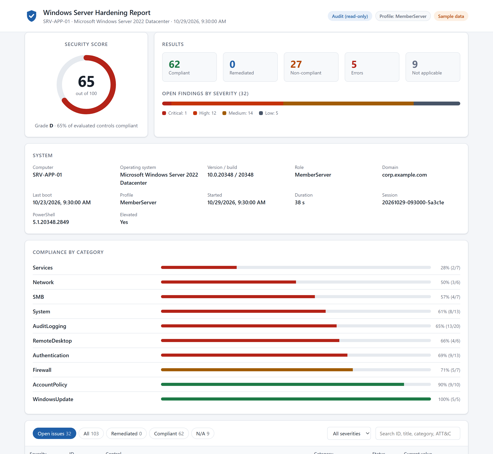
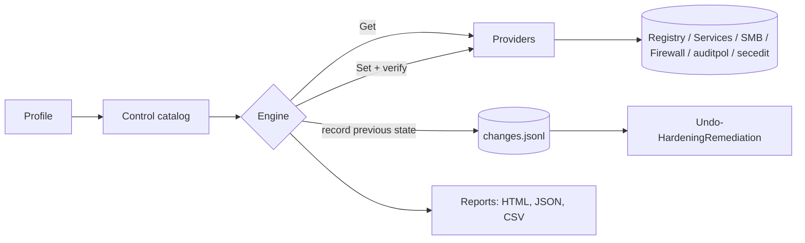

# Windows Server Hardening Toolkit

[](https://github.com/anastanveer653/windows-server-hardening-toolkit/actions/workflows/ci.yml)


[](LICENSE)

A PowerShell module for **auditing, hardening and rolling back** Windows Server security
configuration. The 107 controls live in a data-driven catalog and are mapped to CIS Benchmark
recommendations and MITRE ATT&CK techniques. Every change is verified after it is applied, and every
change can be undone.

```powershell
Invoke-HardeningAudit                   # read-only assessment + HTML/JSON report
Invoke-HardeningRemediation -WhatIf     # preview every change
Invoke-HardeningRemediation             # apply, with per-change rollback data
Undo-HardeningRemediation               # restore the previous configuration
```

<p align="center">
  <a href="https://anastanveer653.github.io/windows-server-hardening-toolkit/docs/sample-report.html"><b>View a live sample report</b></a> &middot;
  <a href="docs/CONTROLS.md"><b>Control reference</b></a> &middot;
  <a href="docs/ARCHITECTURE.md"><b>Architecture</b></a> &middot;
  <a href="docs/COMPATIBILITY.md"><b>Compatibility</b></a>
</p>

<p align="center">
  <a href="https://anastanveer653.github.io/windows-server-hardening-toolkit/docs/sample-report.html">
    <picture>
      <source media="(prefers-color-scheme: dark)" srcset="docs/images/report-dark.png">
      
    </picture>
  </a>
  <br>
  <sub>The self-contained HTML report (sample data). Select the image to open the interactive version.</sub>
</p>

---

## Why this toolkit

Most hardening scripts are a long list of `Set-ItemProperty` calls: they are hard to review, they
cannot tell you what they changed, and nobody knows how to undo them. This toolkit treats hardening
as a controlled change:

| | |
|---|---|
| **Audit first** | The default mode is read-only. You get a scored report before anything changes. |
| **Preview** | `-WhatIf` lists the exact registry value, service, policy or firewall setting that would change. |
| **Record, apply, verify** | The previous state is saved *before* each change; afterwards the setting is read back. A value that does not persist (for example because Group Policy overrides it) is reported as an error, not as fixed. |
| **Roll back** | One command restores values, removes registry keys and firewall rules the run created, and restores service start types. |
| **Explain** | Every finding says why it matters, what it can break, which CIS recommendation it maps to and which ATT&CK techniques it mitigates. |
| **Automate** | JSON and CSV output, a versioned report schema, exit codes for schedulers and pipelines, and remote audits over WinRM. |

## Coverage

| Category | Controls | Highlights |
|---|---:|---|
| SMB | 7 | SMBv1 server and client driver, server and client signing, encryption, null sessions, insecure guest logons |
| Authentication | 13 | NTLMv2-only, LM hashes, WDigest, LSA protection (RunAsPPL), NTLM session security, CredSSP oracle, anonymous enumeration, Credential Guard |
| AccountPolicy | 10 | Password length, history, age and complexity, reversible encryption, lockout threshold, duration and window, Guest account |
| AuditLogging | 22 | Advanced audit policy (by GUID), Kerberos auditing on DCs, process command lines, PowerShell script block logging, event log sizes |
| Firewall | 7 | All profiles enabled, default inbound block, dropped-packet logging, log size, cleartext protocol blocks, RDP exposure analysis |
| Services | 14 | Print Spooler (PrintNightmare), Remote Registry, Telnet, SNMP, UPnP/SSDP, consumer services |
| System | 14 | UAC, local account token filtering, AutoRun/AutoPlay, inactivity lock, logon banner, SEHOP, DEP, Secure Boot |
| RemoteDesktop | 7 | NLA, TLS security layer, encryption level, password prompts, drive and clipboard redirection |
| Network | 8 | LLMNR and NetBIOS poisoning, source routing, ICMP redirects, SSL 2.0/3.0, TLS 1.0/1.1 (opt-in) |
| WindowsUpdate | 5 | Automatic update policy, install schedule, patch recency, pending updates |

The full list, with expected values, implementation details and ATT&CK links, is in
[docs/CONTROLS.md](docs/CONTROLS.md), which is generated from the catalog.

## Quick start

Requirements:

- Windows Server 2012, 2012 R2, 2016, 2019, 2022 or 2025, with Desktop Experience or Server Core, in any language.
- Windows PowerShell 5.1 (built in from Server 2016; install [WMF 5.1](https://aka.ms/wmf51download) on 2012 / 2012 R2) or PowerShell 7.
- An elevated session for hardening and for the audit and account policy checks.

Version-specific behaviour is described in [docs/COMPATIBILITY.md](docs/COMPATIBILITY.md).

**Tested on real servers**

| Windows Server | Scope | Result |
|---|---|---|
| 2025 Datacenter (build 26100), PowerShell 5.1 and 7 | Audit, harden, verify, idempotency, rollback | 12/12 checks; score 46 -> **95** -> 46 after rollback |
| 2022 Datacenter (build 20348), PowerShell 5.1 and 7 | Audit, harden, verify, idempotency, rollback | 12/12 checks; score 47 -> **95** -> 47 after rollback |
| 2016 Standard (build 14393, .NET 4.6.2), on-premises | Audit only | 102 controls evaluated, **0 errors** |

Windows Server 2022 and 2025 are retested by CI on every push.

The full verification log is in [docs/COMPATIBILITY.md](docs/COMPATIBILITY.md#verification-log).

```powershell
git clone https://github.com/anastanveer653/windows-server-hardening-toolkit.git
cd windows-server-hardening-toolkit

# 1. Audit (read-only). Writes HTML, JSON and CSV to %ProgramData%\WindowsServerHardening\reports
.\Harden-WindowsServer.ps1

# 2. Preview the changes
.\Harden-WindowsServer.ps1 -Mode Harden -WhatIf

# 3. Harden (asks for confirmation; add -Force for unattended runs)
.\Harden-WindowsServer.ps1 -Mode Harden

# 4. Roll back the last hardening session if needed
.\Harden-WindowsServer.ps1 -Mode Rollback
```

Sample console output:

```
  Windows Server Hardening Toolkit v2.0.1
  ------------------------------------------------------------------
  Mode      : AUDIT (read-only)
  Computer  : SRV-APP-01 (MemberServer, Microsoft Windows Server 2022 Datacenter build 20348)
  Profile   : MemberServer
  Session   : 20261029-093000-5a3c1e
  ------------------------------------------------------------------
  Score     : 65 / 100   Grade D
  Results   : 62 compliant  0 remediated  27 non-compliant  5 errors  9 n/a

  Top open findings
   [Critical] AUTH-001  LAN Manager authentication level is NTLMv2 only
   [High]     AUTH-002  LAN Manager password hashes are not stored
   [High]     AUTH-004  LSASS runs as a protected process (RunAsPPL)
   ...
```

## Using the module

```powershell
Import-Module .\src\WindowsServerHardening\WindowsServerHardening.psd1

# Audit specific areas and work with the results in the pipeline
$run = Invoke-HardeningAudit -Category SMB, Authentication -NoReport
$run.Results | Where-Object Status -in 'Fail', 'Error' | Sort-Object Severity | Format-Table Id, Severity, Title, Actual

# Remediate a subset without prompts, using wildcards
Invoke-HardeningRemediation -ControlId 'SMB-*', 'AUTH-00*' -Force

# Explore the catalog
Get-HardeningControl -Severity Critical, High | Format-Table Id, Title, Expected
Get-HardeningControl -Id 'AUTH-003' | Format-List Title, Rationale, Impact, Benchmark, MitreAttack

# Sessions and rollback
Get-HardeningSession
Undo-HardeningRemediation -SessionId 20261029-101500-a1b2c3 -WhatIf
```

| Command | Purpose |
|---|---|
| `Invoke-HardeningAudit` | Read-only assessment, locally or with `-ComputerName` over WinRM |
| `Invoke-HardeningRemediation` | Apply a profile with `-WhatIf` / `-Confirm` support and rollback data |
| `Undo-HardeningRemediation` | Restore the state from before a remediation session |
| `Get-HardeningSession` | List remediation sessions and their rollback state |
| `Get-HardeningControl` | Browse the catalog or the effective controls of a profile |
| `Get-HardeningProfile` | List profiles or show a resolved profile |
| `Export-HardeningReport` | Write HTML, JSON and/or CSV reports for a run |

Every command has full help: `Get-Help Invoke-HardeningRemediation -Full`.

## Profiles

| Profile | Use for | Differences |
|---|---|---|
| `MemberServer` | Domain-joined and standalone servers | Baseline aligned with CIS Level 1; disruptive controls are opt-in |
| `DomainController` | Domain controllers | Adds Kerberos auditing, 4 GB Security log; account policy audited only (manage it in the Default Domain Policy) |
| `WebServer` | IIS and application servers | Disables TLS 1.0/1.1, keeps FTP reachable, 10-minute inactivity lock |

`-ProfileName Auto` (the default) picks `DomainController` on domain controllers and `MemberServer`
otherwise. Custom profiles extend a built-in one and only describe the differences:

```json
{
  "Name": "Contoso-FileServer",
  "Extends": "MemberServer",
  "EnableControls": ["SYS-014", "RDP-007"],
  "ExcludeControls": ["SMB-005"],
  "AuditOnlyControls": ["WU-*"],
  "Parameters": {
    "MinimumPasswordLength": 16,
    "LegalNoticeText": "Contoso property. Authorized use only."
  }
}
```

```powershell
.\Harden-WindowsServer.ps1 -Mode Harden -ProfilePath .\Contoso-FileServer.json -WhatIf
```

## Reports

- **HTML**: a single self-contained file with no external resources, so it works on servers
  without internet access. It shows the score ring, open findings by severity, compliance per
  category, and a filterable, searchable list of controls with rationale, remediation and ATT&CK
  links. It supports light and dark mode and prints cleanly.
- **JSON**: a versioned schema (`schemaVersion: 1.0`) for SIEM, CMDB or dashboard ingestion.
- **CSV**: one row per control, for spreadsheets and ticketing imports.

The **security score** weights each evaluated control by severity (Critical 10, High 5, Medium 3,
Low 1). Errors count as non-compliant; controls that do not apply are excluded.

## Automation

`Harden-WindowsServer.ps1` returns exit code `0` when everything is compliant, `1` when there are
findings and `2` when the run fails. Use it in scheduled tasks, RMM tools or deployment pipelines:

```powershell
# Weekly compliance snapshot as a scheduled task (runs as SYSTEM)
$action  = New-ScheduledTaskAction -Execute 'powershell.exe' -Argument '-NoProfile -ExecutionPolicy Bypass -File "C:\Tools\WSH\Harden-WindowsServer.ps1" -ReportFormat Json,Html'
$trigger = New-ScheduledTaskTrigger -Weekly -DaysOfWeek Monday -At 6am
Register-ScheduledTask -TaskName 'Hardening audit' -Action $action -Trigger $trigger -User 'SYSTEM' -RunLevel Highest

# With powershell.exe -File, separate list values with commas and no spaces (Json,Html; SMB-*,NET-*)

# Audit a fleet from an admin workstation; one report per server
.\Harden-WindowsServer.ps1 -ComputerName (Get-Content .\servers.txt) -Credential (Get-Credential)
```

## Safety model

- Audit is the default. Hardening requires `-Mode Harden` and confirmation, or `-Force`.
- Controls that commonly break workloads (Windows Script Host, TLS 1.0/1.1, RDP clipboard) are
  **opt-in**. Each control documents its operational impact.
- State is written to `sessions\<id>\changes.jsonl` before each change, so even an interrupted run
  can be rolled back.
- Settings that cannot be changed safely by a script (Secure Boot, DEP, Credential Guard, patching,
  RDP exposure) are **audit-only** and come with manual remediation guidance.
- On domain-joined servers, Group Policy wins. The toolkit detects values that GPO reverts and
  reports them. For fleets, use it to find drift and build your GPO baseline.

> Always run an audit and `-WhatIf` first, and test in a non-production environment.
> Some settings (LSA protection, SCHANNEL, SMBv1 client driver) take effect after a restart.

## How it works



Controls are declarative entries in `src/WindowsServerHardening/Controls/*.psd1`, so adding a
setting takes no new code. Providers implement `Get`, `Set` and `Restore` for each kind of setting.
Audit policy is addressed by subcategory GUID and account policy through `secedit`, so the checks
also work on non-English Windows installations. Details: [docs/ARCHITECTURE.md](docs/ARCHITECTURE.md).

## Development

```powershell
Install-Module Pester -MinimumVersion 5.5.0 -Scope CurrentUser -Force -SkipPublisherCheck
Install-Module PSScriptAnalyzer -Scope CurrentUser -Force

.\build.ps1              # PSScriptAnalyzer, Pester with coverage, regenerate docs and sample report
.\build.ps1 -Task Test
```

The unit tests run without administrator rights. They include an end-to-end test that hardens real
registry values on Pester's `TestRegistry:` drive, rolls them back, and verifies the original state.

On every push and pull request, CI runs:

- the unit tests on Windows Server 2022 and 2025, under Windows PowerShell 5.1 and PowerShell 7;
- the **integration test** on disposable Windows Server 2022 and 2025 runners. It audits the runner,
  hardens it, verifies that the changes persist, checks that a second run changes nothing, rolls
  everything back, and confirms that the configuration matches the baseline.

To verify any other release (2012 to 2019) on your own VM, run the integration test:

```powershell
.\tests\Integration\Invoke-IntegrationTest.ps1   # elevated; take a VM snapshot first
```

```
src/WindowsServerHardening/   module: manifest, catalog, profiles, engine, providers, reporting
tests/                        Pester suites, fixtures and the integration test
tools/                        documentation and sample report generators
docs/                         control reference, architecture, compatibility, sample report
Harden-WindowsServer.ps1      command line front end
build.ps1                     analyze / test / docs tasks
```

## Limitations

- Remote support covers audits only; remediation runs locally on each server.
- Account policy on domain members is usually overridden by domain policy; manage it through GPO.
- The CIS references quote recommendation titles. Validate the values against the benchmark version
  your organisation has adopted before you claim compliance.

## Contributing and security

Contributions are welcome; see [CONTRIBUTING.md](CONTRIBUTING.md). Report vulnerabilities privately
as described in [SECURITY.md](SECURITY.md). Changes are tracked in [CHANGELOG.md](CHANGELOG.md).

## License

[MIT](LICENSE) &copy; Anas Tanveer
