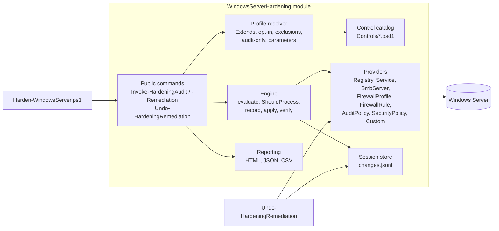

# Architecture

The toolkit is a PowerShell module (`src/WindowsServerHardening`) with a thin command line front end
(`Harden-WindowsServer.ps1`). Controls are **data**, not code: a control declares *what* the setting
should be, and a small set of providers knows *how* to read, change and restore each kind of setting.



## Folder layout

```
src/WindowsServerHardening/
  WindowsServerHardening.psd1      Module manifest (version, exports, metadata)
  WindowsServerHardening.psm1      Loader: dot-sources Private/ and Public/
  WindowsServerHardening.Format.ps1xml  Console table views for runs, results and sessions
  Controls/NN-<Category>.psd1      Control catalog, loaded in file order
  Profiles/<Name>.json             Built-in profiles
  Public/                          Exported commands (one per file)
  Private/                         Engine, catalog, profiles, session store, helpers
  Private/Providers/               One file per control type
  Private/Reporting/               Report document, HTML template, CSV
tests/                             Pester 5 suites and fixtures
tools/                             Doc and sample report generators
```

## Control schema

```powershell
@{
    Id             = 'SMB-004'                      # <PREFIX>-<NNN>, unique
    Title          = 'SMB client requires packet signing'
    Category       = 'SMB'
    Severity       = 'High'                         # Critical | High | Medium | Low
    Type           = 'Registry'                     # provider name
    Target         = @{                             # provider specific
        Path = 'HKLM:\SYSTEM\CurrentControlSet\Services\LanmanWorkstation\Parameters'
        Name = 'RequireSecuritySignature'
        ValueType = 'DWord'
        # AbsentValue = 1        documented Windows default when the value is not set
        # SkipIfKeyMissing = $true  report NotApplicable when the key does not exist
    }
    Expected       = 1                              # value to compare with and to set
    Operator       = 'Equals'                       # Equals | GreaterOrEqual | LessOrEqual | Range | In
    # Minimum = 1; Maximum = 5                      Range bounds (Maximum defaults to Expected)
    # Allowed = @(1, 2)                             In: acceptable values
    # Parameter = 'MinimumPasswordLength'           profile parameter that overrides Expected
    Rationale      = 'Why the control matters.'
    Impact         = 'What can break.'
    RebootRequired = $false
    AuditOnly      = $false                         # evaluate only, never remediate
    OptIn          = $false                         # only when listed in a profile's EnableControls
    # Roles = @('DomainController'); ExcludeRoles = @('DomainController')
    References     = @{
        Benchmark   = 'CIS: Microsoft network client: Digitally sign communications (always) = Enabled'
        MitreAttack = @('T1557.001')
        Links       = @('https://learn.microsoft.com/...')
    }
}
```

`ConvertTo-HardeningControl` validates every entry when the catalog loads, and the catalog tests
check the whole catalog (unique IDs, ATT&CK ID format, GUID format, value types, parameters).

## Provider contract

A provider for type `X` is a set of private functions:

| Function | Purpose |
|---|---|
| `Get-XState -Control [-Context]` | Returns `New-ControlState` with `Value`, `Exists`, `Display`, `Applicable`, `Reason`, optional `Compliant` and `Extra` (anything needed for rollback). |
| `Set-XState -Control [-Context] [-State]` | Applies `Control.Expected`. Must be idempotent. |
| `Restore-XState -Change` | Restores the recorded previous state; returns `@{ Status = 'Restored' or 'Skipped'; Detail }`. |
| `Test-XState -Control -State` (optional) | Custom compliance logic (for example audit policy bit flags). Otherwise the generic operator comparison is used. |

`-Context` carries the run mode, profile parameters, system information and a per-run cache. The
audit and security policy providers use the cache so `auditpol` and `secedit` run once per run, and
a failure is cached too, so the remaining controls fail fast with the same message.

## Remediation flow

For each control the engine (`Invoke-HardeningControlCore`):

1. Skips the control if its `Roles` / `ExcludeRoles` do not match the server role.
2. Reads the current state. Not applicable means status `NotApplicable`; compliant means `Pass`.
3. In audit mode, or for audit-only controls, stops with `Fail`.
4. Calls `ShouldProcess` (`-WhatIf` / `-Confirm`). Declined means `Fail` with the planned change.
5. **Appends the previous state to `changes.jsonl` before changing anything**, so a crash mid-run
   can still be rolled back.
6. Applies the change with inner confirmation disabled, then reads the state again. Compliant means
   `Fixed`; otherwise `Error` (typically Group Policy enforcing another value).

Provider exceptions never stop the run; they become `Error` results with the message.

## Rollback

`Undo-HardeningRemediation` replays `changes.jsonl` in reverse order:

- Registry values are restored with their original kind; values that did not exist are removed and
  keys created by the run are deleted again once empty.
- Firewall rules created by the run are removed; pre-existing rules get their enabled state and
  action back.
- Services get their start type back (including delayed auto start) and are restarted if they were
  running.
- SMB, firewall profile and audit policy settings are set to their previous values.
- Security policy settings are restored with `secedit`; settings that were undefined before are
  reported as `Skipped` because secedit cannot undefine a value.

The session is marked `RolledBack` only when every change was processed without failure.

## Scoring

Each evaluated control contributes its severity weight (Critical 10, High 5, Medium 3, Low 1). The
score is the weighted share of `Pass` and `Fixed` controls; `Error` counts as non-compliant and
`NotApplicable` is excluded. Grades: A >= 90, B >= 80, C >= 70, D >= 60, otherwise F.

## Report schema

The JSON report (`schemaVersion` 1.0) contains `generator`, `session`, `system`, `summary`
(score, grade, counts, `openBySeverity`, `categories`) and `results` (one object per control with
id, title, category, severity, status, expected, actual, detail, remediation, rationale, impact,
benchmark, mitreAttack and links). The HTML report embeds the same document; every value is
rendered with `textContent`, and `<`, `>` and `&` are escaped inside the embedded JSON.
